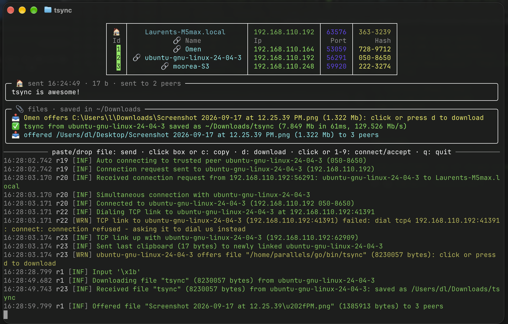

[](https://pkg.go.dev/fortio.org/tsync)
[](https://github.com/fortio/tsync/actions/workflows/include.yml)
[](https://codecov.io/github/fortio/tsync)

# tsync

Secure clipboard (and soon file) sharing between your machines, from a cross platform terminal UI (TUI): macOS, Linux and Windows.

Run `tsync` on each machine on your local network: they find each other automatically, you approve each new machine once (checking a short hash, trust on first use), and from then on they reconnect on their own over an end to end encrypted link. Paste text into tsync on one machine, click to copy it on another.

Also a reusable Go library for local network discovery, authenticated encrypted peer links and clipboard/file transfer (`tsnet` and `tcrypto` packages).

**Status**: clipboard sharing works and is used daily between macOS, Windows and Linux (including VMs). File sharing (drag and drop a file, click to download on the other machines) is being added next.



## Install

Get the binary from [releases](https://github.com/fortio/tsync/releases), or

```
brew install fortio/tap/tsync
```

or with Go
```
CGO_ENABLED=0 go install fortio.org/tsync@latest  # installs in ~/go/bin typically
CGO_ENABLED=0 go run fortio.org/tsync@latest      # to run without installing
```

Install the same version on all your machines: the protocol is still evolving and older versions are flagged as incompatible ("(old version)" next to their name).

## Usage

Run `tsync` on each machine. Discovered peers are listed in the table (`🏠` is this machine, with its hash).

- **Connect**: click on a peer (or press its number). It turns yellow; on the other machine it blinks blue, with a bell and a highlighted "wants to connect: check the hash" line.
- **Accept**: on the other machine, check that the hash shown matches the one on the first machine's `🏠` line, then click (or press its number). Both turn green, and get a 🔗 once the encrypted link is up.
- Accepted peers are remembered and reconnect automatically next time (when either side restarts, or after a network hiccup).
- **Share text**: paste (Cmd-V, Ctrl-Shift-V...) into tsync: it's sent to all the linked peers and shows in a box below the table (on yours too). Peers that connect later also get the last thing you shared.
- **Copy**: click on a box (or press `c` for the latest received) to copy it to your clipboard.
- `q` (or Ctrl-C) to quit.

The log scrolls below the table and boxes; `-loglevel debug` for more details.

### Clipboard support in terminals

Copying uses the OSC 52 terminal escape sequence, which your terminal must support and allow: Ghostty, kitty, WezTerm, Windows Terminal work out of the box; iTerm2 needs "Applications in terminal may access clipboard" enabled; in tmux add `set -g set-clipboard on`. Apple's Terminal doesn't support it.

Text received from peers is sanitized (escape sequences and control characters removed) before being displayed or copied.

### Flags

```
tsync help
```

Most useful ones:
- `-name` to use another name than the hostname (eg 2 instances on the same machine).
- `-peers host[:port],...` to also send discovery directly to these addresses, when multicast doesn't work at all (some VPNs, cloud VMs...). Default port is the discovery one (29556).
- `-auto-connect=false` to not automatically connect to already accepted peers.
- `-clip-lines` max number of lines shown per clipboard box (default 3).
- `-port`, `-mcast` to use a different discovery port/multicast group (eg separate groups of machines).

### Trying on a single machine

Run 2 instances with different names and identities, eg `tsync -name a` and `HOME=/tmp/b tsync -name b`.

### Troubleshooting

- **Peer not listed**: multicast must work between the machines. When it only works one way (eg a VM using NAT/"shared" networking: the host sees the VM but not the other way around), tsync also sends its discovery directly to the peers it sees, so both sides still find each other. If it doesn't work at all, use `-peers`.
- **Stays yellow**: the other side hasn't accepted yet, or didn't receive the request (tsync retries a few times; click again to retry later).
- **Green but no 🔗**: the encrypted link is a TCP connection on a random port: allow tsync in your firewall (macOS asks on first run, Windows: allow on private networks). Through NAT, the side that can't be reached asks the other one to connect instead.
- **(old version)** next to a peer: upgrade tsync on that machine.
- **Forget a peer**: accepted peers are stored in `~/.tsync/checked.pub` (`%USERPROFILE%\.tsync\checked.pub` on Windows), one per line. Remove its line (or the whole file) and restart tsync. Don't remove `id`/`id.pub` in that directory: that's this machine's identity (a new one means a new hash, and all peers have to accept it again).

## How does it work?

- **Interface**: tsync first figures out which interface and local address to use by checking how a configurable target is reached (`-target`, defaults to UDP 8.8.8.8:53, one of Google's public DNS servers; nothing is actually sent there). That avoids picking the WSL virtual interface on Windows, for instance.
- **Discovery**: every ~1.5s (plus random jitter) each instance sends its name, public key and a random per run id to a multicast group (default 239.255.116.115:29556), and directly to the peers it knows (and `-peers`). Peers not heard from for 10s are removed.
- **Identity**: each machine has a long term Ed25519 key pair in `~/.tsync/` (created on first run). The hash shown (`DDD-DDDD`) is derived from its public key: comparing it on both sides is what makes the first connection trustworthy (trust on first use).
- **Handshake**: connection requests and accepts carry a fresh X25519 ephemeral key signed with the sender's identity, bound to both run ids (no replay from previous runs). Both sides derive session keys with HKDF (SHA-256), one AES-256-GCM key per direction.
- **Link**: one side then opens a TCP connection; all frames on it are encrypted and authenticated (counter nonces, so no replay or reordering), and the first one proves it's the right peer.
- **Clipboard**: the text (up to 1 MiB) with the time it was copied is sent to all the linked peers; the receiver keeps the newest.

## Docker

```
docker run --network host -v ~/.tsync:/home/user/.tsync -ti fortio/tsync
```
but multicast, which tsync needs for discovery, doesn't seem to work at least on Docker for Mac.

## Development

```
make test   # unit and (local network multicast) integration tests
make lint   # golangci-lint with the fortio shared config
make e2e    # end to end TUI test: 2 instances in tmux, connect, paste, copy, restart (needs tmux)
```
